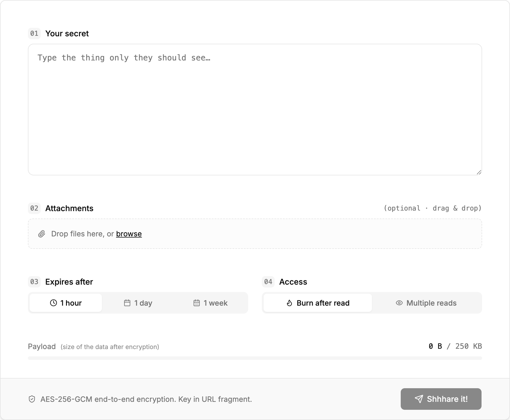
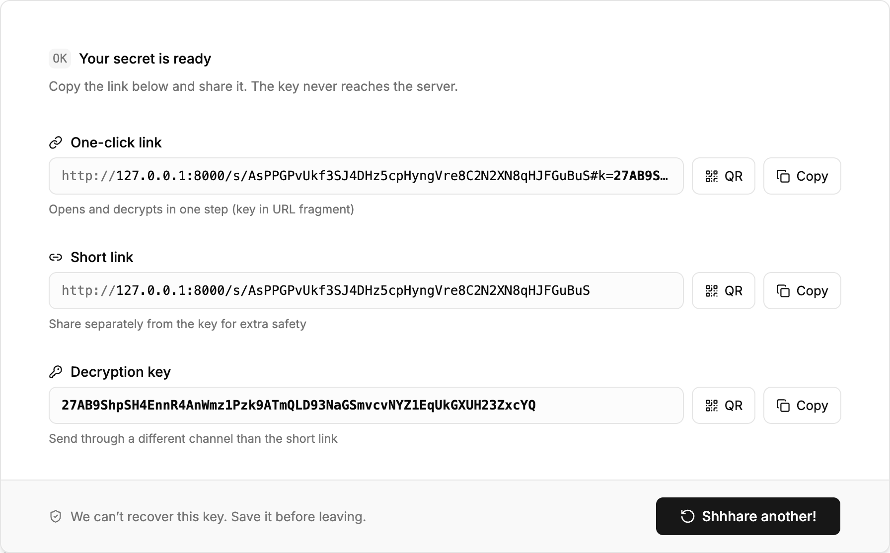
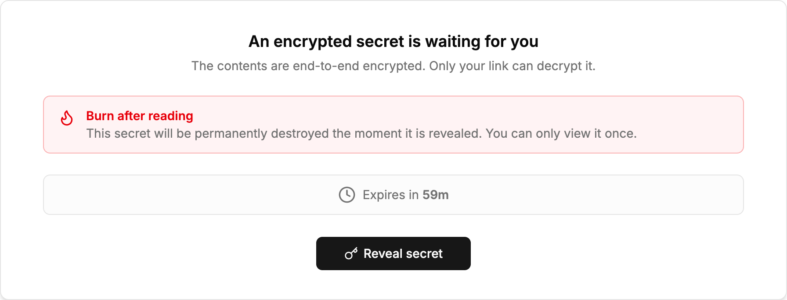

# Shhhare!

> Share secrets, not regrets.

**Shhhare!** is a self-hostable, end-to-end encrypted, one-time-secret service. Paste a password, API key, or any sensitive snippet, and get back a single short link to share. The recipient opens it, reads the secret, and it's gone.

The server never sees your plaintext. Encryption and decryption happen entirely in the browser using the Web Crypto API, inside dedicated Web Workers. Only the ciphertext is stored (in Redis or Cloudflare KV), behind a randomly generated identifier — and the symmetric key only ever lives in the URL fragment, which browsers do not send to the server.

---

## Highlights

- **Zero-knowledge by design** — AES-GCM 256-bit encryption in the browser; the key is encoded into the URL fragment (`#…`) and never reaches the backend.
- **Burn-after-reading** — optional one-time access; the ciphertext is deleted from storage on first successful read.
- **TTL-based expiry** — secrets auto-expire after 1 hour, 1 day, or 1 week (Redis `EXPIRE` / KV `expiration_ttl`).
- **Pluggable storage** — Redis (default) or [Cloudflare Workers KV](https://developers.cloudflare.com/kv/) via its REST API.
- **Fast, tiny, single-binary backend** — async Rust on top of [Poem](https://github.com/poem-web/poem) + Redis or Cloudflare KV, with the SPA and docs embedded into the binary via `rust-embed`.
- **OpenAPI out of the box** — `poem-openapi` produces a live schema served at `/doc/schema.json`, with a [Scalar](https://github.com/scalar/scalar) reference UI at `/doc/`.
- **Modern frontend** — React 19 (with the React Compiler) + TanStack Router + Tailwind v4, native `<dialog>` and form controls, and QR-code sharing via `react-qr-code`. It runs under a strict Content-Security-Policy.
- **Containerized** — multi-stage Dockerfile produces a small `debian:stable-slim` image with a single static-ish binary.

---

## Screenshots

### 1. Compose a secret

Type the payload, optionally attach files, pick an expiry (1 hour / 1 day / 1 week) and an access mode (burn-after-read or multiple reads). The live payload meter shows the encrypted size against the configured `MAX_SIZE`.



### 2. Share the link

After encryption, you get a one-click link (with the key in the URL fragment), a short link (without the key — share it through a separate channel), and the raw decryption key. Each has a Copy button and a QR code for easy hand-off.



### 3. Reveal on the other side

The recipient sees a clear warning when the secret is set to burn after reading, plus the remaining TTL. Decryption only happens after they explicitly click **Reveal secret**.



---

## Architecture

```
┌────────────────────┐        ┌──────────────────────────┐        ┌────────────┐
│  Browser (React)   │        │  shhhare (Rust / Poem)   │        │ Redis / KV │
│                    │        │                          │        │            │
│  ┌──────────────┐  │ HTTPS  │  /            (SPA)      │        │            │
│  │ encrypt.ts   │──┼───────▶│  /doc/        (Scalar)   │───────▶│            │
│  │ (Web Worker) │  │ cipher │  /static/...  (assets)   │ cipher │            │
│  └──────────────┘  │  only  │  /api/health             │  only  │  KV + TTL  │
│  ┌──────────────┐  │        │  /api/secret  POST/GET   │        │            │
│  │ decrypt.ts   │◀─┼────────│                          │◀───────│            │
│  │ (Web Worker) │  │        |                          |        |            |
│  └──────────────┘  │        │                          │        │            │
└────────────────────┘        └──────────────────────────┘        └────────────┘
        ▲
        │ key lives only in URL fragment (#...) — never sent to the server
```

### Crypto flow

1. The browser packs the text and attachments into a binary container and pads it to a multiple of 256 bytes, so the server can't tell the exact length of short secrets (see [Payload format](#payload-format)).
2. It generates a random 256-bit AES-GCM key and a 12-byte IV, and encrypts the container. The envelope `0x01 (version) ‖ iv ‖ ciphertext ‖ tag` is Base64-encoded and `POST`ed to `/api/secret`, together with a TTL and a `bar` ("burn-after-read") flag. The version byte is authenticated as additional data.
3. The server stores the ciphertext under a random Base58-encoded 32-byte key with a TTL. In Redis, it stores `"<bar>|<ciphertext>"` with `EXPIRE` and `NX` to avoid collisions. In Cloudflare KV, the value is the ciphertext and the key's metadata holds `{ "bar", "exp" }`, with `expiration_ttl` set.
4. The server returns the storage `key`. The browser builds a share link of the form:

   ```
   https://your-host/s/<storage-key>#<base58(rawKey)>
   ```

5. On open, the recipient's browser checks the secret's status with `GET /api/secret/:key` (which doesn't consume it). Only when they click **Reveal secret** does it fetch the ciphertext with `POST /api/secret/:key` (and, if `bar` is set, the server deletes the entry), then decrypt it with the key from the fragment. The key's format is validated before that request, so a mistyped key never burns a secret.

### Payload format

The plaintext that gets encrypted is:

```
headerLength (u32, big-endian) ‖ header (UTF-8 JSON) ‖ file bytes… ‖ zero padding
```

The header is `{"t": "<text>", "f": [{"n": "<name>", "t": "<mime type>", "s": <size>}]}`, and the file bytes follow in header order. Attachments are stored as raw bytes (no Base64 inside the ciphertext), and the padding is capped so it never pushes a payload over `MAX_SIZE`. The app computes the exact size the server will check before encrypting anything, so the size meter is instant.

### Repository layout

```
shhhare/        Rust backend (Poem + poem-openapi + Redis / Cloudflare KV)
shhhare_app/    React 19 SPA (TanStack Router, Tailwind v4)
shhhare_doc/    Vue 3 app embedding Scalar API reference for /doc/
Dockerfile      Multi-stage build: Node (frontends) → Rust (backend) → Debian
```

The two frontends are built first, their `dist/` outputs are copied into `shhhare/files/`, and `rust-embed` bakes them into the final binary so the backend ships as a single executable.

---

## Quick start

### With Docker

```sh
docker build -t shhhare .
docker run --rm -p 8000:8000 \
    -e HOST=0.0.0.0 \
    -e REDIS_URL=redis://host.docker.internal:6379 \
    shhhare
```

Or, with Cloudflare KV as storage:

```sh
docker run --rm -p 8000:8000 \
    -e HOST=0.0.0.0 \
    -e STORAGE=cloudflare-kv \
    -e CLOUDFLARE_ACCOUNT_ID=<account id> \
    -e CLOUDFLARE_KV_NAMESPACE_ID=<namespace id> \
    -e CLOUDFLARE_API_TOKEN=<token with Workers KV Storage: Edit> \
    shhhare
```

Then open <http://localhost:8000>.

### Local development

You'll need:

- [Rust](https://rustup.rs/) 1.95+ (edition 2024)
- Node.js 24 (a `volta` pin is included)
- A running Redis instance (e.g. `docker run -p 6379:6379 redis:7`), or a Cloudflare KV namespace

Build the frontends so the backend can embed them:

```sh
# SPA
cd shhhare_app && npm install && npm run build && cd -

# API reference UI
cd shhhare_doc && npm install && npm run build && cd -
```

Run the backend:

```sh
cd shhhare
REDIS_URL=redis://127.0.0.1:6379 cargo run --release
```

Server output:

```
[ 📦 ] Connecting to Redis...
[ 🚀 ] Listening on http://127.0.0.1:8000
```

For frontend hot-reload, run the Vite dev server in `shhhare_app` (`npm run dev`) alongside the backend. It proxies `/api/`, `/doc/` and `/favicon.svg` to `http://127.0.0.1:8000`.

Run the frontend's checks with `npm run lint` and `npm test` (Vitest unit tests for the crypto and payload code).

---

## Configuration

The backend is configured through CLI flags or matching environment variables (via `clap` + `dotenvy`). A `.env` file in the working directory is loaded automatically.

| Flag                           | Env var                      | Default     | Description                                                                 |
| ------------------------------ | ---------------------------- | ----------- | --------------------------------------------------------------------------- |
| `--host`                       | `HOST`                       | `127.0.0.1` | Bind address.                                                               |
| `--port`                       | `PORT`                       | `8000`      | Bind port.                                                                  |
| `--max-size`                   | `MAX_SIZE`                   | `256KB`     | Maximum ciphertext size. `KB/MB/GB` are decimal; `KiB/MiB/GiB` are binary.  |
| `--storage`                    | `STORAGE`                    | `redis`     | Storage backend: `redis` or `cloudflare-kv`.                                |
| `--redis-url`                  | `REDIS_URL`                  | —           | Redis connection URL, e.g. `redis://127.0.0.1:6379`. Required for `redis`.  |
| `--cloudflare-account-id`      | `CLOUDFLARE_ACCOUNT_ID`      | —           | Cloudflare account ID. Required for `cloudflare-kv`.                        |
| `--cloudflare-kv-namespace-id` | `CLOUDFLARE_KV_NAMESPACE_ID` | —           | Workers KV namespace ID. Required for `cloudflare-kv`.                      |
| `--cloudflare-api-token`       | `CLOUDFLARE_API_TOKEN`       | —           | API token with *Workers KV Storage: Edit*. Required for `cloudflare-kv`.    |

---

## HTTP API

The full schema is available at `GET /doc/schema.json` and rendered at `GET /doc/`.

### `POST /api/secret`

Store an encrypted secret.

```json
{
  "val": "<base64 ciphertext>",
  "ttl": "H",   // "H" = 1 hour, "D" = 1 day, "W" = 1 week
  "bar": true   // burn-after-read
}
```

Responses:

- `200 OK` → `{ "key": "<base58 storage key>" }`
- `400 Bad Request` — payload exceeds `--max-size`
- `409 Conflict` — extremely rare key collision (Redis only)
- `500 Internal Server Error`

### `GET /api/secret/:key`

Peek at metadata without consuming the secret.

- `200 OK` → `{ "ttl": <seconds>, "bar": <bool> }`
- `404 Not Found`

### `POST /api/secret/:key`

Read (and, if `bar=true`, delete) the secret.

- `200 OK` → `{ "val": "<base64 ciphertext>", "ttl": <seconds> }`
- `404 Not Found`

### `GET /api/health`

Pings Redis (`PING`) or Cloudflare KV (namespace lookup). Returns `200 OK` when healthy, `503 Service Unavailable` otherwise.

---

## Security notes

- **The encryption key never touches the server.** It is generated client-side and only ever appears in the URL fragment, which browsers do not include in HTTP requests.
- **Storage IDs are unguessable.** 32 random bytes (`getrandom`) Base58-encoded, stored with `SET … NX EX <ttl>` (Redis) or `expiration_ttl` (Cloudflare KV).
- **Run behind TLS in production.** A fragment is only as private as the transport. Terminate HTTPS at a reverse proxy (Caddy, nginx, Traefik, …) in front of `shhhare`.
- **Storage is the trust boundary for availability.** Redis or Cloudflare KV only ever sees ciphertext, but anyone with access to it can delete or expire entries.
- **Cloudflare KV is eventually consistent.** A delete can take up to about 60 seconds to reach every edge location, so with KV, burn-after-reading is best-effort: a second read within that window may still succeed. KV also has no conditional write, so the `NX` collision check is skipped. Use Redis if you need strict one-time reads.
- **`MAX_SIZE` caps DoS surface** for oversized payloads — tune it for your deployment.
- **Strict browser hardening.** App pages are served with a `Content-Security-Policy` that only allows same-origin scripts, styles, fonts, workers and API calls (no inline code), plus `frame-ancestors 'none'`. Every response sets `X-Content-Type-Options: nosniff`, `Referrer-Policy: no-referrer`, `X-Frame-Options: DENY` and `Cross-Origin-Opener-Policy: same-origin`. The `/doc/` page is the exception for CSP, because the Scalar UI needs inline styles.
- **Secrets stay out of third-party tools.** The secret textarea opts out of spell-check, autofill and the Grammarly and password-manager extensions, and each encryption or decryption runs in a short-lived Web Worker that is terminated right after.

---
